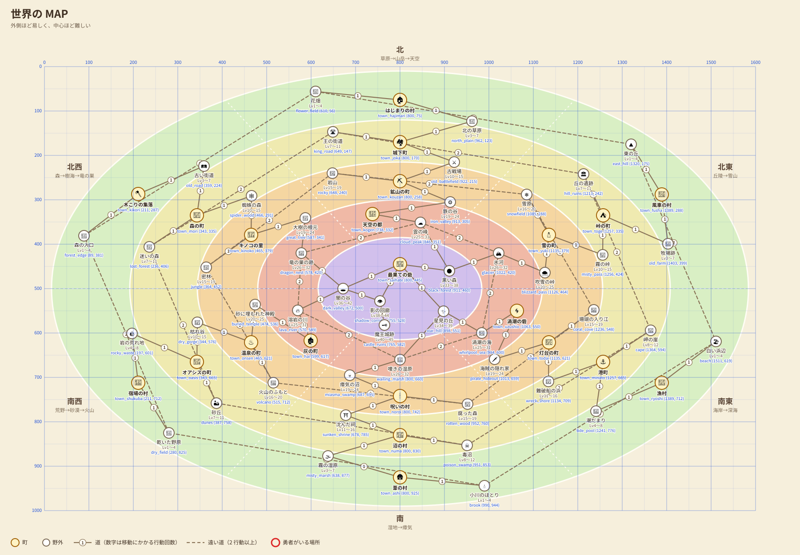

# ベースの地図の作り方

世界の地図（`heroes/MAP.svg`）の一番下に敷く、ベースの地図（地形の絵）の条件です。
町・野外の印、名前、道と行動回数、勇者の札は、プログラムが毎日その上に重ねて描きます。

下敷きの参考に、今の場所の位置・難易度の帯の目安・座標の目盛りを描いた画像を用意しています: [map-guide.svg](map-guide.svg)



## 1. 大きさと形式

| 項目 | 条件 |
|---|---|
| 大きさ | **1600 × 1000（横長、16:10）**。地図の座標とピクセルが 1 対 1 になる |
| 形式 | **SVG がおすすめ**（`viewBox="0 0 1600 1000"`）。PNG / JPEG / WebP でもよい |
| ファイルの大きさ | **300KB 以下が目安**。1MB を超えるとデータのチェックで止まる |
| ファイル名 | `world/map-base.svg`（PNG なら `world/map-base.png` など） |

- SVG の場合: 外部のファイル・フォント・画像を読み込まないこと（GitHub では表示されない）。スクリプトも入れない。
  文字（`<text>`）は入れない。Inkscape・Figma・Illustrator などから「SVG で書き出し」でよい
- PNG / JPEG / WebP の場合: 毎日のコミットで地図の画像全体が書き換わるので、できるだけ軽くする（JPEG / WebP の品質 70〜80 程度）
- 縦横比が違うと引き伸ばされるので、必ず 1600 × 1000 にする

## 2. 地図の形

**メルカトル図法のような、長方形の世界地図**です。北が上。大陸・島・海・川・山脈などで自由に描いてください。

- 地図の四辺いっぱいまで描く（海で囲んでも、陸が端まで続いてもよい）
- メルカトル図法では左右の端がつながりますが、このゲームでは**左右はつながりません**。左右の端は海にしておくと自然です
- 上端・下端を極地（氷の海など）にしても構いません

## 3. 難易度の配置（地図の端ほど易しく、中央ほど難しい）

地図の**端のほうが易しく、中央に向かって段階的に難しく**なります。中央 (800, 500) が一番難しい地域です。
下の「目安の楕円」は、中心 (800, 500) からの横・縦の半径です。境目は楕円でなくて構いません。海岸線・山脈・川などで自然に区切ってください（参考画像に目安の楕円を描いています）。

| 帯 | 目安の楕円（中心からの 横 × 縦） | レベル | 地形のイメージ |
|---|---|---|---|
| 外縁 | 608×380 の外側 〜 地図の端 | Lv1〜8 | のどかな草原・海辺・森の入口 |
| 第二圏 | 456×285 〜 608×380 | Lv7〜16 | 街道・遺跡・沼・砂丘 |
| 第三圏 | 320×200 〜 456×285 | Lv15〜25 | 山岳・雪原・密林・火山 |
| 内縁 | 184×115 〜 320×200 | Lv25〜32 | 天空・氷河・深海・溶岩 |
| 中央 | 中心 〜 184×115 | Lv33〜45 | 闇の大地（最後の砦・魔王城跡） |

中央の地域は、険しい山脈や海で囲まれた「近づきにくい土地」に見えるようにすると、雰囲気が出ます。

## 4. 地域の並び

中央を囲んで、6 つの地域が並びます。それぞれ地図の端から中央に向かって、テーマが変わっていきます。

| | 左 | 真ん中 | 右 |
|---|---|---|---|
| **上段** | 北西: 森 → 樹海 → 竜の巣 | 北: 草原 → 山岳 → 天空 | 北東: 丘陵 → 雪山 |
| **下段** | 南西: 荒野 → 砂漠 → 火山 | 南: 湿地 → 瘴気 | 南東: 海岸 → 深海 |

- 地域どうしの境目も自由です（川・山脈・海峡など）
- テーマは目安です。描いた地形に合わせて、場所の名前やテーマはこちらで直せます（例: 上端を極地にしたので、北は雪原にする、など）

## 5. 描くもの・描かないもの

- **描く**: 地形（陸・海・川・湖・山・森・砂漠・雪など）、地域や難易度の帯の境目となる自然の地形
- **描かない**: 町・建物の印、場所の名前などの文字、道（道と行動回数はプログラムが描く）、凡例、方角の名前、方位記号

## 6. 見やすくするために

- 色は**彩度を少し落とした落ち着いた色**にする（上に重ねる印・文字・赤い札が目立つように）
- 細かい模様は控えめにする（GitHub では幅 900px ほどに縮小して表示されることが多い）
- 参考画像の場所の位置のまわり（半径 30 ほど）は、印と名前が乗るので、ごちゃごちゃさせない
- 場所の位置は、あとから地図に合わせて動かせる（次の 7.）。参考画像の位置にこだわらなくてよい

## 7. 置き方と、場所の位置合わせ

1. ベースの地図を `world/map-base.svg` に置き、`world/map.json` の `layout` に `"background": "map-base.svg"` を足す
   （ベースの地図があるときは、プログラムは難易度の帯の色分けと地域の区切りを描かない）
2. 確認用の地図を書き出して、ブラウザで開く（座標の目盛りと、場所ごとの ID と今の座標が出る）

   ```sh
   python scripts/rpg.py --map-grid /tmp/map-grid.svg
   ```

3. 地図の絵に合わせて、`world/map.json` の場所ごとの `"pos": [x, y]` を直す（x は右へ 0〜1600、y は下へ 0〜1000）
4. 2〜3 を繰り返して、見た目がよくなったら確かめてコミットする

   ```sh
   python -m unittest discover -s tests   # データのチェック（ファイルの大きさ・形式も確かめる）
   python scripts/rpg.py --map            # heroes/MAP.md と MAP.svg を書き出す
   ```

場所の位置合わせ（3.）は、ベースの地図を置いてもらえれば、こちらでも行えます。
場所を新しく足すときも、`pos` を書けば地図に載ります（`pos` のない場所は地図に描かれません）。
