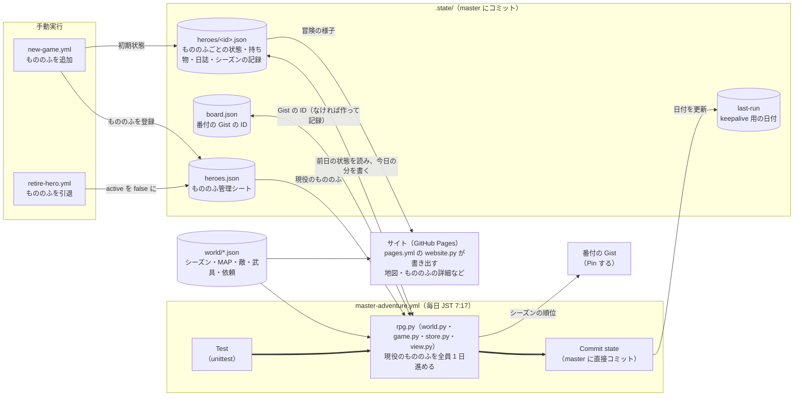
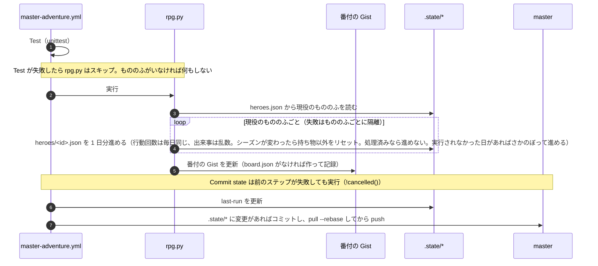
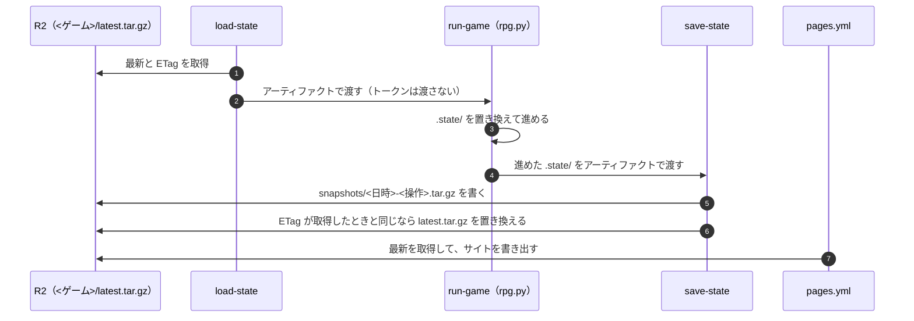
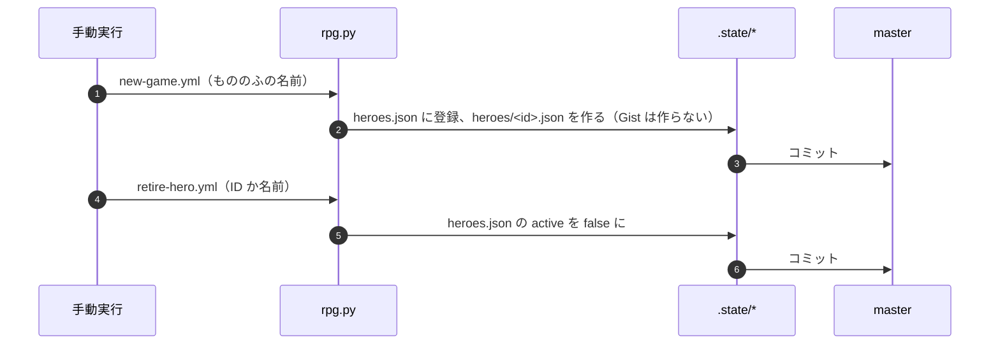

# データの流れ

どの workflow（とスクリプト）が、どのファイルを読み書きし、それが何に使われるかをまとめます。

## 全体図

- 太線（`master-adventure.yml` の中）: ステップの実行順。各ステップの実行条件は下の「毎日の workflow の処理順」を参照
- 実線: データの読み書き
- 手動実行の workflow は毎日の workflow と同じ `concurrency` グループで、`.state/` への書き込みが重ならないようにしている
- Variable `R2_STATE_BRANCHES` に入れたゲームは、`.state/` をブランチにコミットせず Cloudflare R2 に置く（下の「状態を R2 に置くゲーム」）

## ファイルごとの役割

| ファイル | 書き込み元 | 中身 | 使い道 |
|---|---|---|---|
| `world/*.json` | 人（手で編集） | テキスト RPG の世界（シーズン・MAP・敵・武具・口入れ屋の依頼）。形式は README の「世界を広げる」 | `rpg.py` の入力（Test で検証してから使う） |
| `.state/heroes.json` | `rpg.py`（New game / Retire hero） | もののふの一覧（ID・名前・作成日・現役かどうか）。現役は最大 30 人 | 毎日の更新の対象 |
| `.state/heroes/<id>.json` | `rpg.py` | もののふの状態（場所・HP・レベル・依頼など）、持ち物、直近 30 日の日誌、シーズンの記録 | 翌日の続きと、Gist の表示 |
| `.state/board.json` | `rpg.py`（最初の毎日の実行） | 番付の Gist の ID と URL | 毎日更新する番付の Gist |
| `.state/guild.json` | `rpg.py`（毎日の実行） | 町ごとの口入れ屋の高札（日をまたいで残る。受付中・受注中・達成・失敗） | もののふが依頼を受ける（早い者勝ち）。サイトの口入れ屋のページで、受付の残り日数と受けたもののふを出す |
| サイト（GitHub Pages） | `website.py`（`pages.yml`） | 地図・番付・口入れ屋の今日の依頼・もののふの詳細の HTML（`.state/` と `world/` から書き出す。コミットしない） | ブラウザで見る。番付の Gist からリンクする |
| `.state/last-run` | Commit state ステップ | 最終実行日（JST） | 60 日無活動で scheduled workflow が止まるのを防ぐ（keepalive） |

`.state/` の各ファイルの JSON 構成・項目の意味・例は [STATE_FORMAT.md](STATE_FORMAT.md) を参照してください。

保持期間:
- `heroes/<id>.json` は毎日上書きします（日誌は直近 30 日分、シーズンの記録と持ち物は無制限）。引退したもののふのファイルはそのまま残ります。
- `heroes.json` はもののふの追加・引退のときだけ書き換えます。
- `board.json` は番付の Gist を作ったときに 1 回だけ書きます。
- `last-run` は毎回上書きします。

## 毎日の workflow の処理順

毎日の実行が終わると（成功・失敗にかかわらず）、`pages.yml` がコミットされた最新の状態で CI（リンター・フォーマット・テスト）を確かめ、通ったらサイトを書き出して GitHub Pages に公開する。
毎日の実行のコミットは GITHUB_TOKEN で push するので push では動かず、`workflow_run` で受ける（もののふの登録・引退のあとも同じ）。

## 状態を R2 に置くゲーム

Variable `R2_STATE_BRANCHES` に入れたゲームは、`.state/` の中身を tar.gz にまとめて Cloudflare R2 に置く（#301。設定は [SETUP.md](SETUP.md) の「5. ゲームの状態を R2 に置く」）。

- ブランチにはコミットしないので、毎日の実行のあとの公開は、ブランチの先端のコミットと R2 の最新で書き出す
- スナップショットは 30 日で消える（ライフサイクルルール）

## もののふを追加・引退させる workflow

