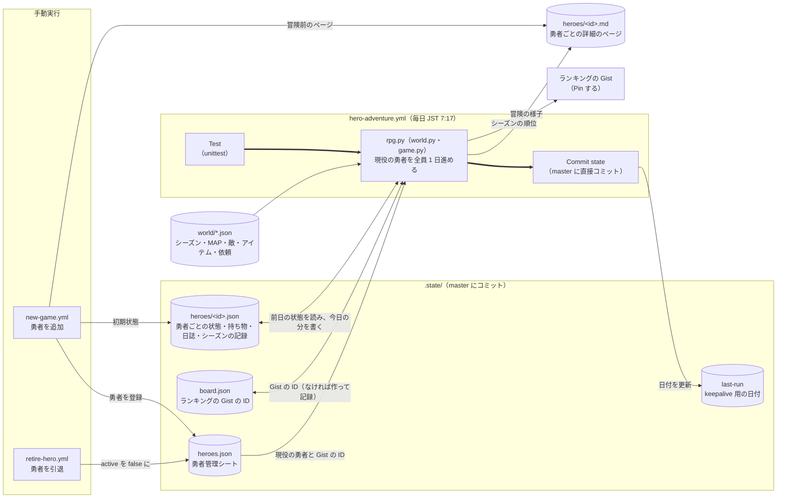
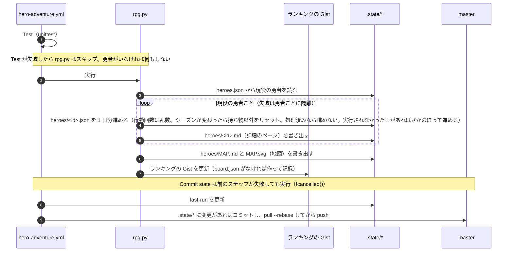
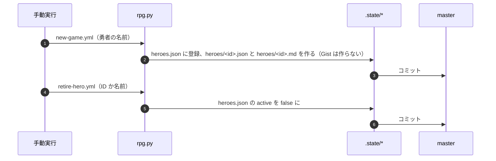

# データの流れ

どの workflow（とスクリプト）が、どのファイルを読み書きし、それが何に使われるかをまとめます。

## 全体図

- 太線（`hero-adventure.yml` の中）: ステップの実行順。各ステップの実行条件は下の「毎日の workflow の処理順」を参照
- 実線: データの読み書き
- 手動実行の workflow は毎日の workflow と同じ `concurrency` グループで、`.state/` への書き込みが重ならないようにしている

## ファイルごとの役割

| ファイル | 書き込み元 | 中身 | 使い道 |
|---|---|---|---|
| `world/*.json` | 人（手で編集） | テキスト RPG の世界（シーズン・MAP・敵・アイテム・ギルドの依頼）。形式は README の「世界を広げる」 | `rpg.py` の入力（Test で検証してから使う） |
| `.state/heroes.json` | `rpg.py`（New game / Retire hero） | 勇者の一覧（ID・名前・Gist の ID と URL・作成日・現役かどうか）。現役は最大 30 人 | 毎日の更新の対象と、更新先の Gist |
| `heroes/MAP.md` / `MAP.svg` | `rpg.py` | 世界の地図の画像（SVG）と Mermaid の図、勇者の現在地 | GitHub 上で見る。ランキングの Gist からリンクする |
| `heroes/<id>.md` | `rpg.py` | 勇者ごとの詳細（ステータス・装備・持ち物・日誌・シーズンの記録）を読むためのページ | GitHub 上で読む。ランキングの Gist からリンクする |
| `.state/heroes/<id>.json` | `rpg.py` | 勇者の状態（場所・HP・レベル・依頼など）、持ち物、直近 30 日の日誌、シーズンの記録 | 翌日の続きと、Gist の表示 |
| `.state/board.json` | `rpg.py`（最初の毎日の実行） | ランキングの Gist の ID と URL | 毎日更新するランキングの Gist |
| `.state/last-run` | Commit state ステップ | 最終実行日（JST） | 60 日無活動で scheduled workflow が止まるのを防ぐ（keepalive） |

`.state/` の各ファイルの JSON 構成・項目の意味・例は [STATE_FORMAT.md](STATE_FORMAT.md) を参照してください。

保持期間:
- `heroes/<id>.json` は毎日上書きします（日誌は直近 30 日分、シーズンの記録と持ち物は無制限）。引退した勇者のファイルはそのまま残ります。
- `heroes.json` は勇者の追加・引退のときだけ書き換えます。
- `board.json` はランキングの Gist を作ったときに 1 回だけ書きます。
- `last-run` は毎回上書きします。

## 毎日の workflow の処理順

## 勇者を追加・引退させる workflow

